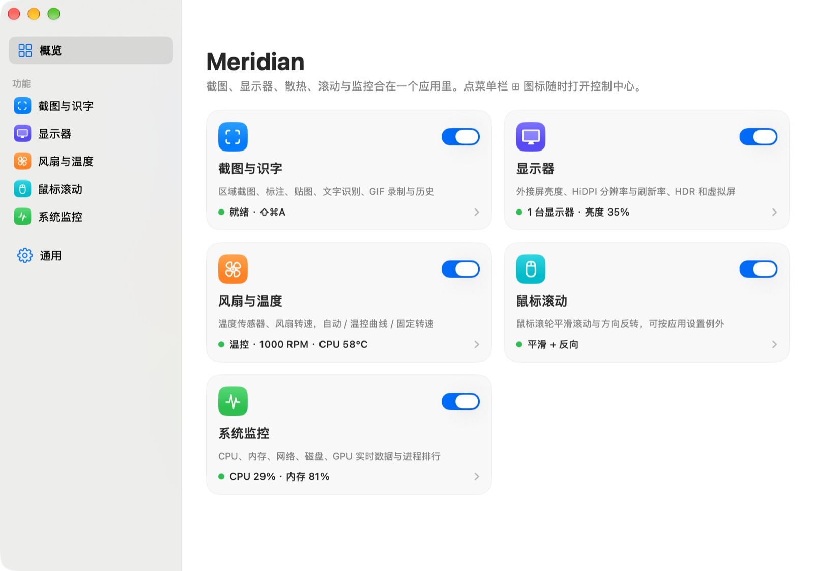
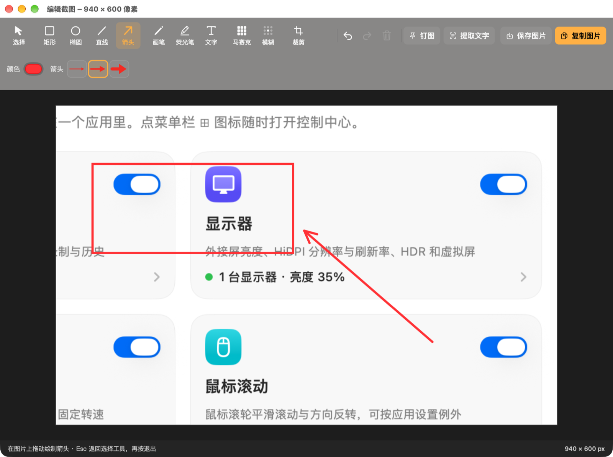
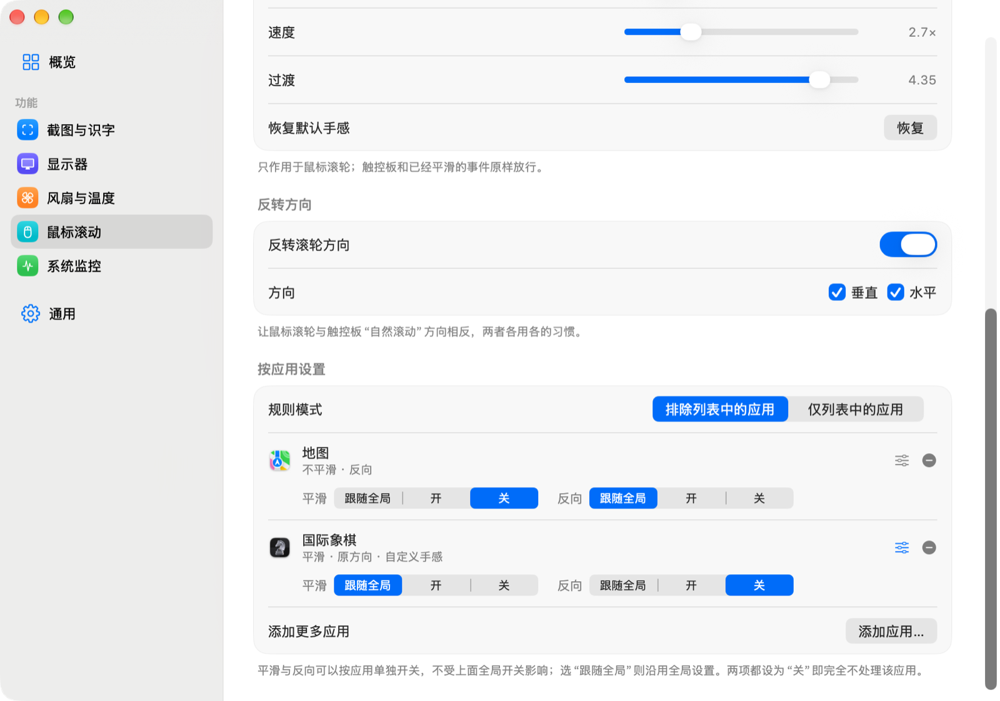
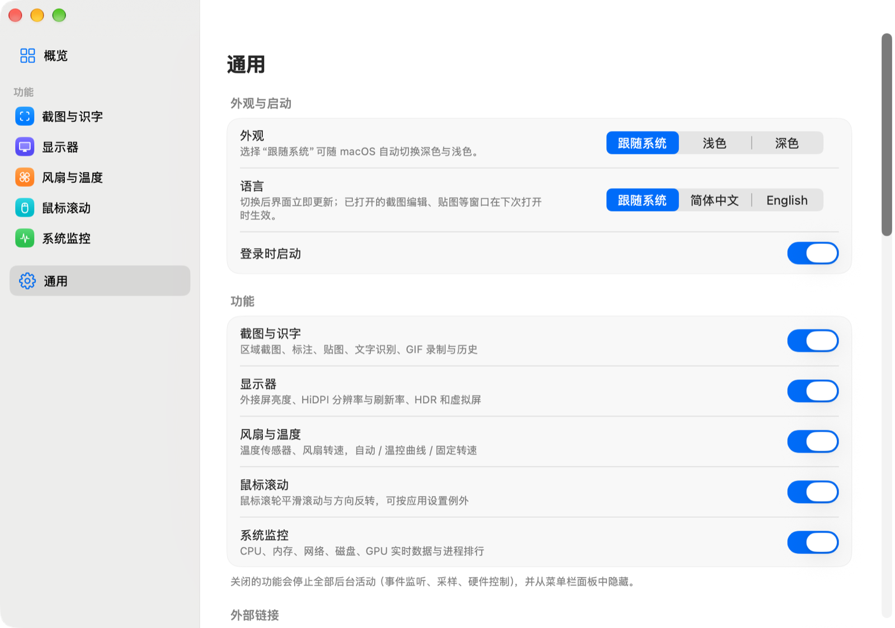
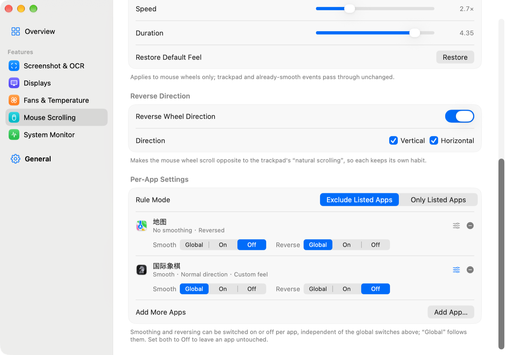

<div align="center">

[简体中文](README.md) · [English](README.en.md)

# Meridian

**把常用的 Mac 工具，收进一个菜单栏。**

截图与识字 · 显示器管理 · 风扇与温度 · 滚动增强 · 系统监控


[快速开始](#快速开始) · [截图预览](#截图预览) · [使用示例](#使用示例) · [使用手册](docs/USER_GUIDE.md) · [常见问题](docs/FAQ.md) · [开发与构建](docs/DEVELOPMENT.md)



</div>

Meridian 取“子午线”之意：它是一条观察与校准系统状态的基准线。这个原生 macOS 菜单栏控制中心把截图、系统负载、显示器、散热与滚动控制收在同一处，功能按需启用，关闭主窗口后仍可在菜单栏运行。

界面使用 SwiftUI 与 AppKit，支持浅色、深色和跟随系统外观。各功能直接运行在同一个应用进程中；需要管理员权限的显示覆盖与风扇写入由独立助手执行。

> **项目状态：1.1.0。** GitHub 包为 Apple Silicon 未公证构建，macOS 可能要求用户手动允许打开；尚未完成 Developer ID 公证和面向其他机型的验证。下载与签名状态以 [Releases](https://github.com/begin2023/meridian/releases) 中的说明为准，发布细节见[发布清单](docs/RELEASING.md)。

## 功能一览

| 模块 | 能做什么 |
| --- | --- |
| 截图与识字 | 区域、窗口、全屏与延时截图；选区标注；本机文字识别；截图贴图；历史记录；最长 30 秒的区域 GIF 录制 |
| 显示器 | 外接屏亮度、软件调暗、HiDPI 分辨率档位与刷新率、HDR（SDR 亮度与亮度提升）、虚拟屏；功能可用性取决于显示器与系统 |
| 风扇与温度 | 查看转速与可读温度；系统自动、固定转速、温度曲线与全速预设；控制需要管理员助手和兼容硬件 |
| 滚动增强 | 平滑滚动、方向反转、按应用单独开关平滑与反向（不受全局开关影响）、临时暂停 |
| 系统监控 | CPU、内存、网络、磁盘与进程排行；菜单栏数据小组件可单独开关 |
| 通用 | 全局快捷键、登录时启动、权限状态、外观设置，界面支持简体中文与英文 |

温度标签使用内置候选探测集，尚不代表已验证的逐机型传感器数据库。没有风扇的 Mac 不提供风扇控制；不支持的显示功能可能不可用。

## 截图预览

<table>
<tr>
<td width="50%" valign="top">

**截图标注**

拖出选区后按 `E` 进入编辑：矩形、箭头、文字、马赛克、模糊、裁剪，一键钉图、提取文字、保存或复制。



</td>
<td width="50%" valign="top">

**按应用设置滚动**

每个应用的“平滑”和“反向”都可以选“跟随全局 / 开 / 关”，单独开关时不受全局设置影响。



</td>
</tr>
<tr>
<td width="50%" valign="top">

**通用设置**

外观、语言（跟随系统 / 简体中文 / English）、登录启动和功能开关集中在一处。



</td>
<td width="50%" valign="top">

**English interface**

切换到 English 后，主窗口、控制中心、菜单与截图工具全部使用英文。



</td>
</tr>
</table>

## 系统要求

- **macOS 26 或更新版本**；新界面直接使用该版本的系统材质与 API。
- 当前构建和验证目标为 **Apple Silicon（arm64）**。尚未提供和验证 Intel 或 Universal 下载包。
- 已有真机记录来自 Mac mini M4、macOS 27.2；尚未完成 macOS 26 与其他机型的发布回归。
- 屏幕录制、辅助功能和管理员权限按使用的功能授予，见[权限说明](docs/USER_GUIDE.md#权限说明)。

## 下载与安装

可在本仓库的 **Releases** 页面下载适合的版本。

1. 下载并解压发布包，将 `Meridian.app` 拖到“应用程序”。
2. 打开 Meridian，从菜单栏图标进入控制中心。
3. 在“通用”中按需开启功能，并完成对应权限授权。

签名、公证、架构与系统要求以每个 Release 的说明为准。GitHub 发布包使用 ad-hoc 签名，其他 Mac 默认不会将开发者身份视为已由 Apple 验证；首次打开可能需要右键选择“打开”，或在“系统设置 → 隐私与安全性”中允许。遇到提示时请先阅读[常见问题](docs/FAQ.md)，不要修改系统的全局安全设置。

## 快速开始

1. **打开控制中心**：左键点击菜单栏主图标。点击 CPU、内存或风扇等数据小组件可直接查看详情。
2. **截一张图**：按 `⌘⇧2`，拖出选区后标注、复制、保存或贴到屏幕上。
3. **识别文字**：按 `⌘⇧1`，拖选文字区域，松开鼠标后识别。
4. **录制 GIF**：按 `⌥⇧G` 选择区域并开始，再按一次停止。
5. **调整设置**：右键菜单栏图标打开主窗口；按 `⌘,` 进入“通用”。

这些是全新安装的默认快捷键；从旧本地版本升级会保留已有设置。截图贴图、暂停滚动和控制中心也可以自定义快捷键。

## 使用示例

**给一张截图做标注再发给同事**

1. 按 `⌘⇧2`（或你设置的截图快捷键），拖出区域。拖动边框和四角可以调整大小，拖动选区内部可以移动。
2. 按 `E` 进入编辑器，用 `R` 画框、`A` 画箭头、`T` 加文字，敏感信息用马赛克或模糊盖住。
3. 按 `⌘C` 复制后直接粘贴到聊天软件，或按 `⌘S` 另存。编辑器里按 `⌘Q` 或 `Esc` 只关闭编辑器，不会退出 Meridian。

**把一段文字从图片里提取出来**

按 `⌘⇧1`，拖选包含文字的区域，松开鼠标后结果出现在选区旁边，点“复制”即可。识别完全在本机完成。

**一边看文档一边对照**

截图后点“钉图”，选区会悬浮在所有窗口之上。滚轮缩放，拖动移动，双击或 `Esc` 关闭。

**全局反向，但游戏里保持原样**

在“鼠标滚动”页打开“反转滚轮方向”，然后在“按应用设置”里添加游戏，把它的“反向”设为“关”。如果某个设计软件不需要平滑，把它的“平滑”设为“关”即可，其余应用照常使用全局设置。

**切换到英文界面**

“通用 › 外观与启动 › 语言”选择 English，主窗口和控制中心立即切换；已经打开的截图编辑、贴图窗口下次打开时生效。

**用链接或快捷指令控制**

```bash
open "meridian://capture"          # 区域截图
open "meridian://open/pointer"     # 打开鼠标滚动设置
open "meridian://resolution/native" # 外接屏回到原生分辨率
open "meridian://fan/auto"         # 风扇交还系统自动
```

会改动硬件或抓取屏幕的链接默认先弹窗确认，可在“通用 › 外部链接”中调整。

## 日常使用

- 菜单栏主图标左键打开面板，右键提供截图、识字、GIF、历史与退出等快捷操作。
- 主窗口侧栏集中放置概览、五个功能页和通用设置。
- 关闭主窗口不会退出应用。完全退出请使用菜单中的“退出 Meridian”。
- 正常退出时应用会请求把风扇交还系统，并清理本次虚拟屏、软件调暗和亮度提升；异常退出与重启行为仍需跨设备验证。
- 同时启用多个处理滚轮或控制同一硬件的工具，可能造成重复处理。排查问题时请逐个暂停相关功能。

更多操作见[使用手册](docs/USER_GUIDE.md)，故障排查见[常见问题](docs/FAQ.md)。English documentation: [User Guide](docs/USER_GUIDE.en.md) and [FAQ](docs/FAQ.en.md).

## 隐私与数据

截图、识字和历史记录由本机模块处理；当前代码未配置云端识字服务、账户系统或遥测上传。截图历史、导出文件与偏好设置会保存在本机，可能包含你截取的敏感内容。

完整说明与目录见[隐私说明](docs/PRIVACY.md)。

## 从源码构建

需要 Swift 6.2+，以及支持 macOS 26+ API 的 SDK。安装相应的 Xcode 或 Command Line Tools，然后在仓库根目录执行：

```bash
# 不需要本机固定证书的开发构建
scripts/build-app.sh release

# 输出：dist/Meridian.app
# 可选：安装到 /Applications 并启动
scripts/install.sh
```

仓库内包含所需的五个本地模块，无需额外的同级项目目录。本地临时签名适合开发，重新构建后可能需要重新授予系统权限。正式分发的签名与公证流程见[发布清单](docs/RELEASING.md)。

目录结构、模块检查及签名方式见[开发文档](docs/DEVELOPMENT.md)。

## 性能

一次本机 Release 对照中，主窗口和面板关闭时，后台 CPU 平均由 3.50% 降至 1.55%，使用界面后再关闭的内存由约 92–93 MB 降至 81–83 MB。

这是短时间、特定配置下的结果，不代表所有机型或工作负载。采样方法、条件与局限见[性能记录](docs/PERFORMANCE.md)。

## 反馈与贡献

欢迎通过本仓库 Issues 提交问题。请注明系统版本、芯片型号、显示器连接方式、复现步骤以及使用的版本；日志和截图请先移除私人信息。

提交代码前请阅读[贡献指南](CONTRIBUTING.md)。目前优先处理跨机型兼容、权限首次授权、管理员助手和发布验证。

## 开源协议

Meridian 使用 [BSD Zero Clause License（0BSD）](LICENSE)。在贡献者有权授权的范围内，你可以自由使用、修改、商用和再分发，无需保留署名；软件按原样提供，不作担保。

系统框架及任何未来加入的第三方组件仍适用各自条款。资源范围与归属说明见 [NOTICES.md](NOTICES.md)。
